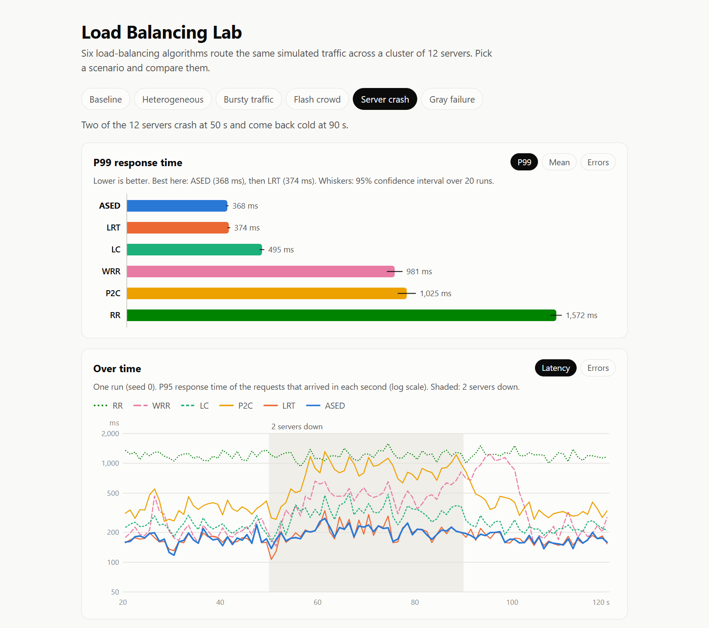
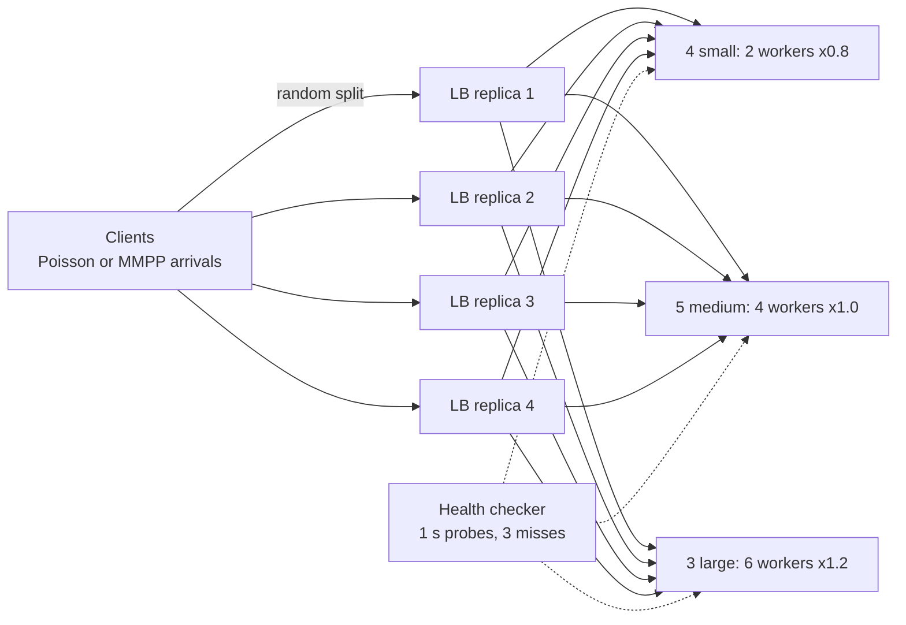
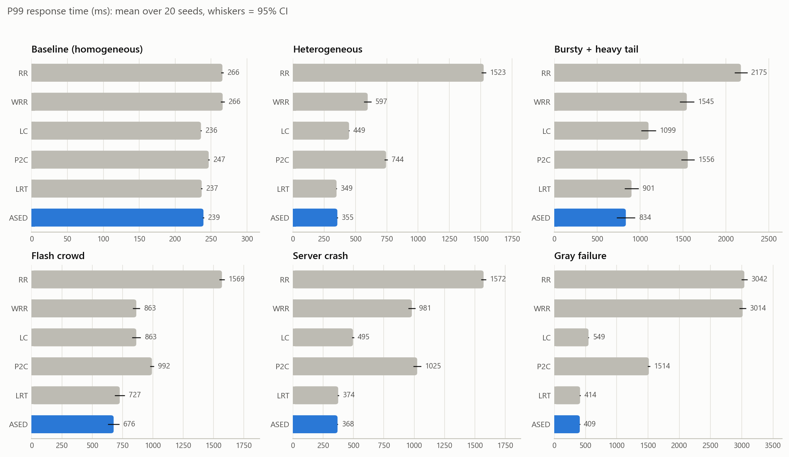
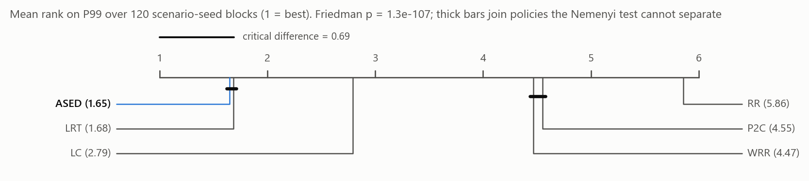
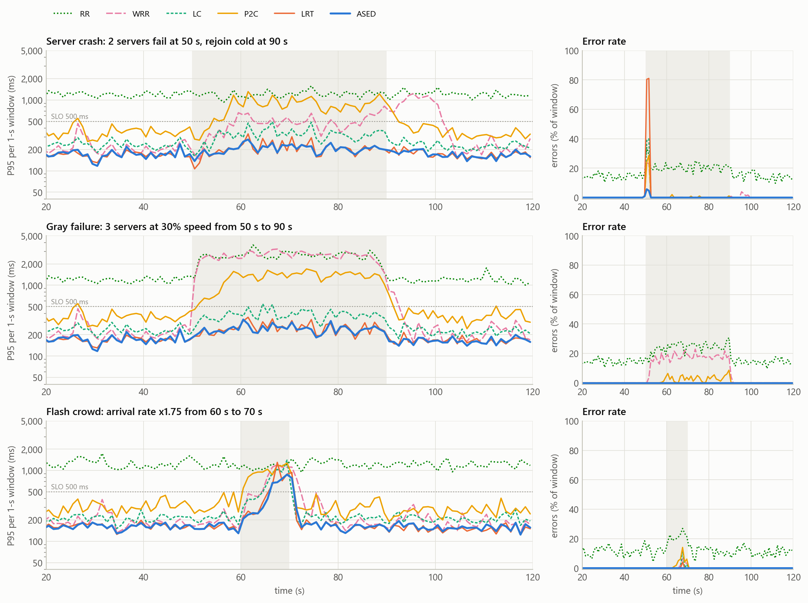
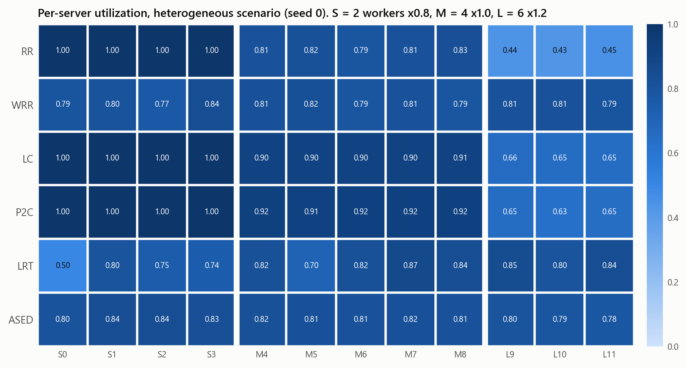
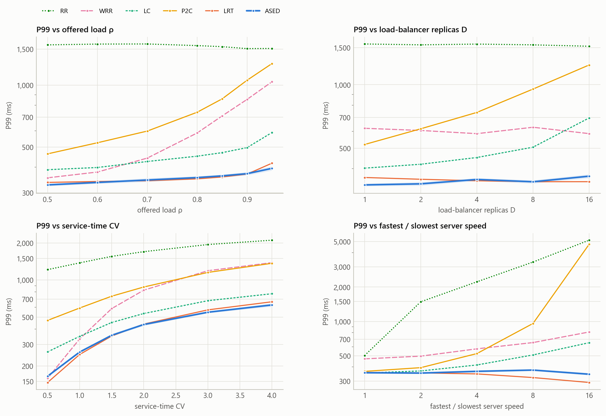
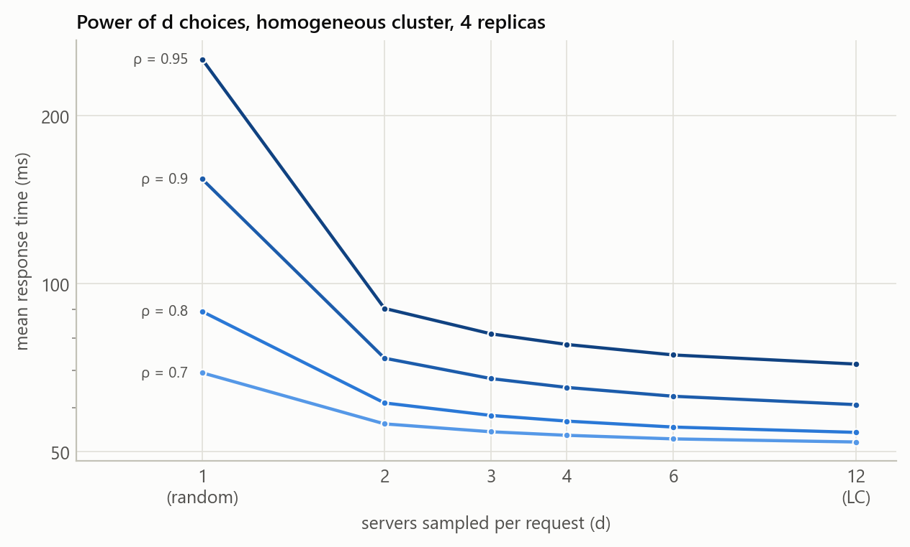
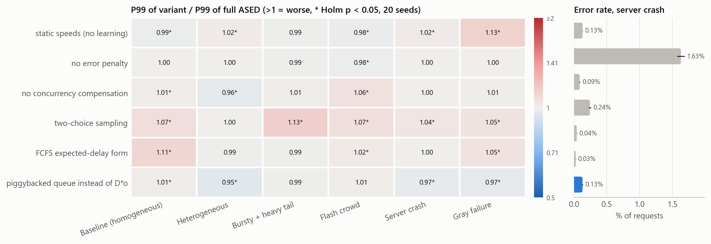
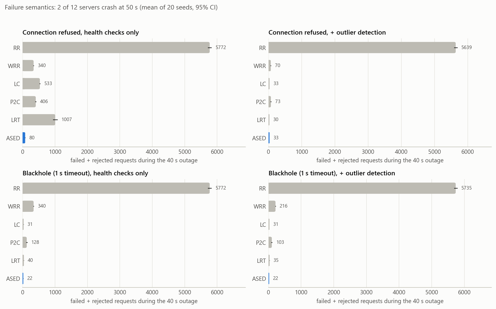

# Adaptive Load Balancing in Distributed Systems: A Comparative Experimental Study

A reproducible discrete-event simulation study of five classic load-balancing algorithms (round robin,
weighted round robin, least connections, power of two choices and least response time) and one adaptive
algorithm designed in this project, **ASED** (Adaptive Shortest Expected Delay). The six are compared on
heterogeneous servers, bursty and heavy-tailed traffic, a flash crowd, server crashes and a gray failure,
with 20 paired seeds per scenario, non-parametric tests, a sensitivity analysis and an ablation study.

* **Demo:** `python -m lbsim demo` opens a small local web page with the results. You can also open
  [`demo/index.html`](demo/index.html) directly in a browser.
* **Reproducible:** `python -m lbsim run all` followed by `python -m lbsim analyze` regenerates every
  table, figure and the demo data in under four minutes.



## Key findings

All numbers are means over 20 seeds with common random numbers. Tests are Wilcoxon signed-rank with
Holm correction. "Errors" means failed plus rejected requests.

1. **ASED and LRT lead, and they are close.** Over 120 scenario-seed blocks the mean rank on P99 latency
   is 1.65 for ASED and 1.68 for LRT, which the Nemenyi test cannot separate (critical difference 0.69).
   On mean latency ASED ranks first (1.53, vs 2.05 for LRT and 2.42 for LC). ASED has the lowest P99 in
   four of the six scenarios, LRT in the heterogeneous one (349 vs 355 ms) and LC in the homogeneous
   baseline (236 vs 239 ms). LRT's P99 is 1 to 2% lower than ASED's in those two scenarios and 1 to 10%
   higher in the other four.
2. **Ignoring capacity is expensive.** On a fleet of three server generations, RR overloads the small
   servers: P99 1,523 ms and 16.6% of requests rejected. LC and P2C balance request *counts* rather than
   work (P99 449 and 744 ms). ASED and LRT reach 355 and 349 ms.
3. **Static weights break silently.** WRR is given the true capacities. It helps on heterogeneous
   servers (597 ms), but it ignores queues. When three servers silently slow to 30% speed, it keeps
   sending them their configured share: P99 3,014 ms and 6.9% errors. ASED, which learns the slowdown
   from response metadata, has 409 ms and no errors.
4. **Fast failures turn least-loaded policies into black holes.** A crashed server that refuses
   connections answers instantly, so it looks idle. Until health checks remove it, LRT loses 1,007
   requests and LC 533. ASED, which charges servers for recent errors, loses 80. With Envoy-style outlier
   detection enabled for every policy, the gap closes (LRT 30, LC 33, ASED 33). When the dead server
   times out instead, count-based policies are safe on their own (LC 31, LRT 40, ASED 22), while open-loop
   WRR still loses 340.
5. **Two random choices are cheap but capacity-blind.** On identical servers at ρ = 0.9, P2C cuts the
   mean latency of a single random choice from 154 ms to 74 ms, close to LC's full scan (61 ms). With
   unequal servers or many balancer replicas it degrades. At a 16:1 speed ratio its P99 reaches 4.7 s,
   and it grows from 521 ms with one replica to 1,241 ms with sixteen.
6. **ASED has measurable weak spots.** With 16 balancer replicas its queue estimate `D * o_i` becomes
   coarse and its mean rises to 83 ms (LRT: 61 ms). With very unequal servers (8:1 and 16:1) it keeps
   the best mean, but LRT's P99 is 14 to 15% lower.
7. **The simulator matches queueing theory.** In 8 closed-form cases (M/M/1, M/M/c, M/G/1, M/D/1,
   M/M/1/K, random splitting, utilization) the maximum error is 1.3%, and every 95% CI covers the
   analytic value.

## Contents

1. [Research questions](#1-research-questions)
2. [System model](#2-system-model)
3. [Policies](#3-policies)
4. [ASED: the proposed policy](#4-ased-the-proposed-policy)
5. [Methodology](#5-methodology)
6. [Results](#6-results)
7. [Discussion: why policies win or lose](#7-discussion-why-policies-win-or-lose)
8. [Limitations and threats to validity](#8-limitations-and-threats-to-validity)
9. [Demo](#9-demo)
10. [Reproducing the study](#10-reproducing-the-study)
11. [Repository layout and tests](#11-repository-layout-and-tests)
12. [References](#12-references)

## 1. Research questions

* **RQ1.** How do static, load-aware and latency-aware policies compare in mean and tail latency,
  throughput, errors and load distribution under heterogeneity, burstiness, spikes and failures?
* **RQ2.** Can a policy that learns server speeds online match policies given accurate static weights,
  and beat them when those weights become wrong?
* **RQ3.** Which ingredients of the adaptive policy matter (ablation)?
* **RQ4.** How do failure semantics (refused connections vs. timeouts) and passive outlier detection change
  the picture?
* **RQ5.** How sensitive are the conclusions to load, number of balancer replicas, service-time
  variability and the degree of heterogeneity?

## 2. System model



* **Servers.** FCFS queues with `c` parallel workers, a speed factor and a bounded waiting room of 16
  requests per worker; a full queue rejects with 503. The heterogeneous fleet has the same total capacity
  (48 worker-units) as the homogeneous one (12 x 4 workers).
* **Requests.** Mean service demand 50 ms on a speed-1 worker; exponential, lognormal (CV 1.5) or bounded
  Pareto (α = 1.2, H/L = 1000, CV ≈ 4.2).
* **Load balancers.** Four independent replicas each receive a random quarter of the requests (as behind
  ECMP or DNS) and only know about their own requests. Network delay is 0.5 ms each way.
* **Faults.** Fail-stop crashes lose the requests in flight. A dead server either refuses connections at
  once or black-holes them until a 1 s timeout. Recovered servers restart cold, ramping from 40% to full
  speed over 15 s. Gray failures keep a server alive but slow. Active health checks are identical for
  every policy.

## 3. Policies

| Policy | Family | Information used | Rule |
|---|---|---|---|
| RR | static | none | round robin, one pointer per replica |
| WRR | static | configured capacity | smooth weighted round robin (nginx) |
| LC | load-aware | own in-flight counts | fewest in-flight requests |
| P2C | load-aware, sampled | in-flight counts of 2 random servers | power of two choices [Mitzenmacher 2001] |
| LRT | latency-aware | EWMA latency + in-flight | argmin latency x (in-flight + 1) (NGINX Plus / Citrix) |
| **ASED** | proposed | piggybacked service time, in-flight, errors | see below |

The five baselines are the algorithms named in the project brief. Together they cover the common families:
oblivious (RR), static weights (WRR), load-aware with a full scan (LC) or with sampling (P2C), and
latency-aware (LRT).

## 4. ASED: the proposed policy

Shortest Expected Delay routes a request to the server minimizing `(n_i + 1) / μ_i`. In practice
neither the queue `n_i` nor the service rate `μ_i` is known to a balancer replica. ASED estimates both
online:

```
score(i) = S_i * (D * o_i + 1) / c_i / (1 - e_i)        -> send to the eligible server with the lowest score
```

| Term | Meaning |
|---|---|
| `S_i` | the server's own log-EWMA of its processing time, piggybacked on every response (as in C3 [Suresh et al. 2015] or ORCA); captures speed differences, slowdowns and cold starts |
| `o_i`, `D` | requests this replica has in flight to `i`, scaled by the number of replicas: with random traffic splitting the other replicas hold about as many (concurrency compensation, after C3) |
| `c_i` | worker count, known from service discovery |
| `e_i` | error rate seen by this replica, EWMA with weight 0.5 that decays with a 2 s time constant; `1 / (1 - e)` is the expected number of attempts, so a fast-failing server stops looking idle after one or two errors |

**How the design was chosen.** Six variants were compared on separate development seeds (1000 to 1005)
before the evaluation seeds were run (table in [`results/tables/design_exploration.md`](results/tables/design_exploration.md)).
Power-of-two sampling and the exact multi-server FCFS formula both looked principled, but they lost to a
full scan with the linear form. The scan keeps the information that sampling throws away. The FCFS
formula's flat region (all servers with a free worker look equal) turns noise in `S_i` into routing
decisions. The individual ideas are not new: SED, piggybacked feedback, concurrency compensation and error
accounting all exist. The contribution is their combination and a systematic evaluation of it.

## 5. Methodology

* **Simulator.** A discrete-event engine written from scratch (`lbsim/engine.py`, binary-heap event
  queue, about 0.4 s per 90k-request run). All policies in a scenario replay the *same* trace of arrival
  times, request sizes and replica assignments (common random numbers), so results are paired by seed.
* **Validation.** The engine reproduces closed-form results within 1.3% ([`results/tables/validation.md`](results/tables/validation.md)):

  | Case | Analytic | Simulated (10 seeds, 95% CI) | Error |
  |---|---:|---:|---:|
  | M/M/1, ρ = 0.8, mean response | 5.0000 | 4.9759 ± 0.2381 | −0.48% |
  | M/M/4, ρ = 0.8 (Erlang C) | 1.7455 | 1.7427 ± 0.0272 | −0.16% |
  | M/G/1 lognormal CV 1.5 (Pollaczek-Khinchine) | 3.4375 | 3.4825 ± 0.1365 | +1.31% |
  | M/D/1, ρ = 0.7 | 2.1667 | 2.1656 ± 0.0246 | −0.05% |
  | M/M/1/5 blocking probability | 0.1260 | 0.1268 ± 0.0025 | +0.62% |

* **Scenarios** (120 s each; the first 20 s are a discarded warm-up):

  | Scenario | Servers | Arrivals | Service | Load | Event |
  |---|---|---|---|---|---|
  | Baseline | homogeneous | Poisson | exponential | 0.80 | none |
  | Heterogeneous | 3 generations | Poisson | lognormal CV 1.5 | 0.80 | none |
  | Bursty + heavy tail | 3 generations | MMPP (x1.5 / x0.5, 2 s sojourns) | bounded Pareto | 0.70 | none |
  | Flash crowd | 3 generations | Poisson | lognormal | 0.60 | rate x1.75 at 60-70 s |
  | Server crash | 3 generations | Poisson | lognormal | 0.70 | 1 medium + 1 large crash at 50 s, rejoin cold at 90 s |
  | Gray failure | 3 generations | Poisson | lognormal | 0.70 | 2 medium + 1 large at 30% speed, 50-90 s |

* **Metrics.** Mean, P50, P95, P99 and P99.9 response time; throughput; error rate; the share of requests
  answered within a 500 ms SLO; per-server utilization, its maximum and Jain's fairness index; and, per
  injected event, errors, P99, "degraded seconds" (1 s windows with P95 > 500 ms or > 1% errors) and
  time to recover.
* **Statistics.** 20 seeds per scenario (10 per sensitivity point). Paired Wilcoxon signed-rank tests with
  Holm correction across all comparisons of a metric; geometric-mean ratios with t intervals on log
  ratios; matched-pairs rank-biserial effect sizes; Friedman test and Nemenyi critical difference over
  scenario-seed blocks [Demšar 2006].
* **Fairness of comparison.** Same traces, same health checks and the same queue limits for every
  policy. Baselines use their textbook form without per-scenario tuning. LRT only learns from successful
  responses, which is the charitable choice: fast errors would make dead servers look even faster.
* **Size.** 4,028 simulation runs: main comparison 720, sensitivity 1,620, ablation 840, failure
  semantics 480, design exploration 288 (development seeds only) and validation 80.

## 6. Results

### 6.1 Main comparison



P99 response time in ms (mean ± 95% CI over 20 seeds; bold = best):

| Policy | Baseline | Heterogeneous | Bursty + heavy tail | Flash crowd | Server crash | Gray failure |
|---|---:|---:|---:|---:|---:|---:|
| RR | 266 ± 2 | 1523 ± 19 | 2175 ± 75 | 1569 ± 23 | 1572 ± 20 | 3042 ± 48 |
| WRR | 266 ± 3 | 597 ± 30 | 1545 ± 84 | 863 ± 30 | 981 ± 29 | 3014 ± 53 |
| LC | **236 ± 1** | 449 ± 4 | 1099 ± 85 | 863 ± 36 | 495 ± 8 | 549 ± 8 |
| P2C | 247 ± 1 | 744 ± 13 | 1556 ± 78 | 992 ± 16 | 1025 ± 33 | 1514 ± 20 |
| LRT | 237 ± 1 | **349 ± 3** | 901 ± 82 | 727 ± 42 | 374 ± 5 | 414 ± 7 |
| **ASED** | 239 ± 1 | 355 ± 3 | **834 ± 107** | **676 ± 47** | **368 ± 4** | **409 ± 4** |

Mean response time in ms:

| Policy | Baseline | Heterogeneous | Bursty + heavy tail | Flash crowd | Server crash | Gray failure |
|---|---:|---:|---:|---:|---:|---:|
| RR | 67.1 | 263.9 | 311.4 | 310.2 | 299.1 | 447.9 |
| WRR | 67.1 | 85.5 | 219.2 | 113.6 | 124.7 | 215.9 |
| LC | **54.1** | 73.8 | 135.1 | 101.5 | 81.0 | 86.3 |
| P2C | 61.1 | 121.2 | 194.6 | 119.7 | 152.8 | 212.3 |
| LRT | 54.8 | 56.6 | 138.0 | **98.0** | 62.3 | 67.7 |
| **ASED** | 56.4 | **55.0** | **122.9** | 98.4 | **60.3** | **63.4** |

Errors in % of requests:

| Policy | Baseline | Heterogeneous | Bursty + heavy tail | Flash crowd | Server crash | Gray failure |
|---|---:|---:|---:|---:|---:|---:|
| RR | 0.00 | 16.63 | 15.78 | 12.86 | 17.34 | 18.53 |
| WRR | 0.00 | 0.02 | 2.09 | 0.30 | 0.62 | 6.92 |
| LC | 0.00 | 0.00 | 0.54 | 0.35 | 0.80 | 0.00 |
| P2C | 0.00 | 0.00 | 1.81 | 0.79 | 0.62 | 0.72 |
| LRT | 0.00 | 0.00 | 0.44 | 0.15 | 1.51 | 0.00 |
| **ASED** | 0.00 | 0.00 | **0.09** | **0.04** | **0.13** | 0.00 |

**Throughput.** With open-loop arrivals, throughput equals the offered rate minus failed and rejected
requests, so it separates policies only when they shed load. In the heterogeneous scenario every policy
except RR delivers the offered 767 req/s, while RR delivers 640 req/s. In the gray failure WRR drops to
625 req/s. In the bursty scenario throughput ranges from 659 req/s (WRR) to 673 req/s (ASED), with RR
at 567 req/s.

Paired tests for ASED against the two strongest baselines (ratio = other / ASED, above 1 favours ASED).
All tables, including SLO attainment, fairness and every paired test, are in [`results/tables/`](results/tables).

| Scenario | vs LRT: P99 ratio [95% CI], p (Holm), ASED better in | vs LC: P99 ratio [95% CI], p (Holm) |
|---|---|---|
| Baseline | 0.99 [0.99, 0.99], <0.001, 1/20 seeds | 0.99 [0.98, 0.99], <0.001 |
| Heterogeneous | 0.98 [0.98, 0.99], <0.001, 1/20 | 1.26 [1.26, 1.27], <0.001 |
| Bursty + heavy tail | 1.10 [1.04, 1.15], 0.011, 15/20 | 1.35 [1.25, 1.45], <0.001 |
| Flash crowd | 1.08 [1.04, 1.11], 0.001, 17/20 | 1.29 [1.22, 1.36], <0.001 |
| Server crash | 1.01 [1.01, 1.02], 0.002, 16/20 | 1.34 [1.33, 1.36], <0.001 |
| Gray failure | 1.01 [1.00, 1.02], 0.033, 13/20 | 1.34 [1.33, 1.36], <0.001 |



### 6.2 Behaviour over time and failure recovery



| Event metric (mean of 20 seeds) | RR | WRR | LC | P2C | LRT | ASED |
|---|---:|---:|---:|---:|---:|---:|
| Crash: errors during the 40 s outage | 5,772 | 340 | 533 | 406 | 1,007 | **80** |
| Crash: degraded seconds (of 40) | 40 | 21.75 | 2.75 | 38.4 | 2 | **2** |
| Rejoin of cold servers: degraded seconds (of 30) | 30 | 11.1 | 0 | 4.55 | 0 | **0** |
| Gray failure: degraded seconds (of 40) | 40 | 40 | 1.7 | 39.65 | 0.05 | **0** |
| Flash crowd: errors (60-90 s) | 3,446 | 184 | 219 | 487 | 92 | **25** |

Event metrics are keyed by arrival time. RR's numbers are dominated by the rejections it causes anyway
by overloading the small servers. LC, LRT and ASED are degraded for two to three seconds after the
crash: until a replica sees an error or the health checker marks the servers down, some new requests
still go to the dead servers. Requests that were already inside the crashed servers are lost for every
policy; they arrived before the outage and only appear in the overall error rate.

### 6.3 Load distribution



RR drives the small servers into saturation (100% busy, 16.6% of all requests rejected) while the large
ones are only about 44% busy. LC and P2C equalize *counts*, so 2-worker servers hold as many requests as 6-worker
ones and saturate as well. WRR equalizes utilization almost perfectly (Jain index 1.000) but ignores
queues, so its P99 is still 597 ms. ASED also spreads load evenly (Jain 0.999) and reacts to queues.
LRT gets the lowest P99 in this scenario with a less even split (Jain 0.967); latency feedback steers
some traffic away from slow servers, and a request that avoids a slow server avoids its long service time.

### 6.4 Sensitivity analysis



* **Load.** On the heterogeneous fleet ASED and LRT stay within 3% of each other on P99 up to ρ = 0.9;
  at ρ = 0.95 ASED's is 6% lower (394 vs 418 ms). WRR degrades quickly with load (355 to 1,040 ms from
  ρ = 0.5 to 0.95) because it ignores queues.
* **Balancer replicas.** Local counts lose information as replicas are added: LC's P99 rises from 402
  to 696 ms between 1 and 16 replicas, P2C's from 521 to 1,241 ms. LRT is the most robust (363 to 347 ms)
  because observed latency includes the queueing caused by other replicas. ASED's P99 stays between 335
  and 369 ms, but its mean rises from 53 to 83 ms at D = 16.
* **Service variability.** ASED's mean barely moves from CV 0.5 to 4 (54.8 to 58.2 ms), while LRT's rises
  from 52.4 to 74.6 ms and WRR's from 55.0 to 180.1 ms. At low variability (CV 0.5) LRT has the lowest
  P99 (147 ms, vs 165 ms for ASED).
* **Heterogeneity.** RR degrades as soon as speeds differ (P99 504 ms on equal servers, 1,487 ms at 2:1),
  and uniformly sampling P2C collapses beyond 4:1 (960 ms at 8:1, 4.7 s at 16:1). LRT's tail improves as
  fast servers get faster (358 to 292 ms); ASED improves its mean (57.1 to 45.9 ms) but not its tail
  (345 ms at 16:1).



On identical servers, sampling a second server removes most of the queueing of random routing, and
more samples bring P2C close to a full scan (mean at ρ = 0.95: 253 ms with d = 1, 90 ms with d = 2,
72 ms for LC).

### 6.5 Ablation



* **Learning speeds** matters when configuration is wrong: static speeds cost 13% P99 in the gray
  failure and are within 2% elsewhere.
* **The error penalty** is what prevents the black hole: without it, the crash error rate rises from
  0.13% to 1.63%. Its latency cost is small: removing it changes P99 by at most 2% (2% lower in the
  flash crowd).
* **Full scan over two-choice sampling**: sampling costs 4 to 13% P99 in 5 of 6 scenarios.
* **The linear form over the FCFS formula**: the FCFS formula costs 11% P99 in the baseline and 2 to 5%
  in the flash crowd and the gray failure.
* **Concurrency compensation** has mixed effects: without it P99 is 4% lower in the heterogeneous
  scenario, 6% higher in the flash crowd and within 1% elsewhere.
* **The piggybacked queue** used as the load estimate instead of `D * o_i` improves P99 by 3 to 5% in three
  scenarios. It is a promising alternative that was not selected on the development seeds (Section 8).

### 6.6 Failure semantics and outlier detection



Whether a failure helps or hurts a policy depends on how the failure looks from outside. Refused
connections make dead servers look idle, which favours error-aware policies. Timeouts make them look
busy, which favours count-based policies. Passive outlier detection (eject after 5 consecutive connection
failures for 10 s) brings LC, LRT and ASED down to 30-33 errors and WRR and P2C to 70-73 when failures
are fast. When failures are timeouts it helps open-loop WRR much less (340 to 216 errors), because every
failure takes the full timeout to be observed. RR stays above 5,600 errors in every condition because
most of its errors are overload rejections, not crash losses.

## 7. Discussion: why policies win or lose

* **Per-request feedback beats static rules.** LRT and ASED, which get feedback on every response from
  every server, beat the open-loop RR and WRR on P99 in every scenario, and LC does so in five of six (it
  ties WRR in the flash crowd). P2C looks at only two servers per decision: on unequal servers its
  uniform sampling costs more than WRR's static weights, except when those weights are wrong (gray
  failure).
* **Static weights are a bet on configuration.** WRR's weights are exactly right in the heterogeneous
  scenario and wrong in the gray failure. Gray failures, noisy neighbours or thermal throttling silently
  break that bet; ASED and LRT notice it in their feedback.
* **Counts are not work.** LC and P2C equalize the number of requests in flight. On unequal servers that
  overloads the small ones; on equal servers it works well (LC has the lowest P99 in the baseline).
* **Mean vs. tail.** ASED's linear expected-delay score uses slow servers in proportion to their
  capacity. That minimizes queueing, and so the mean, but a request that lands on a slow server cannot be
  faster than that server's service time. LRT's latency feedback avoids slow servers a little more, which
  is consistent with LRT winning the tail at large speed ratios while ASED keeps the best mean.
* **Failure handling is part of the policy.** Least-loaded rules are attracted to anything that answers
  quickly, including servers that answer with errors. Error-aware scoring, or outlier detection, is
  necessary for any policy that uses load or latency.
* **Randomized sampling needs weights.** Two choices are excellent with equal servers and no global state,
  but sampling uniformly caps the share a fast server can receive (at most 2/N for N servers).

## 8. Limitations and threats to validity

* **Simulation, not a testbed.** Servers are FCFS multi-worker queues: no processor sharing, caches,
  garbage collection, connection reuse or retries. The time scale is compressed (50 ms requests, 40 s
  faults).
* **Open-loop traffic.** Arrivals do not slow down when the system is slow, which stresses tail behaviour
  more than closed-loop clients would.
* **One fleet shape.** Most results use one 12-server, three-generation fleet; the speed-ratio sweep only
  partly covers other shapes.
* **Six policies only.** The baselines are the five algorithms named in the project brief; an earlier
  version of this study compared ten. Stronger variants exist and are not compared here, notably weighted
  least connections (the default scheduler of Linux IPVS), which adds configured capacities to LC, and
  the latency-based balancers of Envoy and Finagle. In the earlier version (same simulator and seeds),
  weighted least connections in the form argmin (in-flight + 1) / capacity had a 1 to 6% lower P99 than
  ASED in five of the six scenarios (significant in three) when its capacities were exact, and a 26%
  higher P99 in the gray failure. Adding a policy is a single class in `lbsim/policies.py`.
* **Researcher degrees of freedom.** ASED's form was chosen on development seeds disjoint from the
  evaluation seeds. Baselines use their textbook form rather than per-scenario tuning, which a careful
  operator might do.
* **Assumed signals.** ASED assumes that servers report their processing time and that each replica
  knows `D` and `c_i`. Both are realistic (ORCA, Server-Timing, service discovery) but not universal.

## 9. Demo

`python -m lbsim demo` serves the `demo/` folder at http://localhost:8000 and opens it in the browser
(`--port` changes the port, Ctrl+C stops the server). The page is plain HTML, CSS and JavaScript with no
dependencies, so `demo/index.html` also works when opened directly from disk. Pick a scenario to see:

* P99 latency, mean latency or error rate of every algorithm, with 95% confidence intervals;
* P95 latency or error rate per second during one run, with the crash, slowdown or spike shaded;
* a table with all metrics, and a one-line description of each algorithm.

The page reads `demo/data.js`, which `python -m lbsim analyze` writes from `results/`. It follows the
system's light or dark setting.

## 10. Reproducing the study

Requirements: Python 3.10+ with `numpy`, `scipy`, `pandas`, `matplotlib` (see `requirements.txt`).

```bash
pip install -r requirements.txt
python -m lbsim run all          # validation, design, main, sensitivity, ablation, failure (4,028 runs)
python -m lbsim analyze          # tables -> results/tables, figures -> results/figures, demo/data.js
python -m lbsim demo             # open the demo page
python -m pytest                 # 56 tests
```

`python -m lbsim run main --seeds 5` gives a quick version. `python -m lbsim simulate --scenario
gray_failure --policy ased --seed 3` prints the metrics of a single run. On a Ryzen 5 7640HS with 10
worker processes the full study takes under four minutes, and the results committed in `results/` were
produced exactly this way.

## 11. Repository layout and tests

```
lbsim/                   simulation package
  engine.py              discrete-event engine (servers, replicas, health checks, faults)
  policies.py            the six policies, including ASED and its ablation switches
  workload.py            Poisson / MMPP arrivals, exponential / lognormal / bounded-Pareto service
  cluster.py, faults.py  server fleets; crash and slowdown specifications
  scenarios.py           the six evaluation scenarios
  metrics.py             per-run metrics, windows, event and recovery metrics
  experiments.py         experiment grids and the parallel runner
  stats.py               CIs, Wilcoxon + Holm, rank-biserial, Friedman, Nemenyi
  analysis.py            tables and figures;  export.py: demo data
  validation.py          closed-form queueing results used to verify the engine
tests/                   56 tests: queueing-theory validation, policy semantics, engine invariants,
                         workload statistics, statistics helpers, demo export
results/                 raw runs (CSV), tables (CSV/Markdown), figures (PNG)
demo/                    the local demo page (index.html, app.js, style.css, data.js)
notebooks/               walkthrough notebook that reproduces the headline numbers
```

## 12. References

* Y. Azar, A. Broder, A. Karlin, E. Upfal. Balanced allocations. *STOC*, 1994.
* M. Mitzenmacher. The power of two choices in randomized load balancing. *IEEE TPDS* 12(10), 2001.
* M. Mitzenmacher. How useful is old information? *IEEE TPDS* 11(1), 2000.
* W. Whitt. Deciding which queue to join: some counterexamples. *Operations Research* 34(1), 1986.
* L. Suresh, M. Canini, S. Schmid, A. Feldmann. C3: cutting tail latency in cloud data stores via adaptive
  replica selection. *NSDI*, 2015.
* B. Wydrowski, R. Kleinberg, S. Rumble, A. Archer. Load is not what you should balance: introducing
  Prequal. *NSDI*, 2024.
* J. Dean, L. Barroso. The tail at scale. *Communications of the ACM* 56(2), 2013.
* M. Harchol-Balter. *Performance Modeling and Design of Computer Systems*. Cambridge University Press, 2013.
* R. Jain, D. Chiu, W. Hawe. A quantitative measure of fairness and discrimination for resource
  allocation in shared computer systems. DEC TR-301, 1984.
* J. Demšar. Statistical comparisons of classifiers over multiple data sets. *JMLR* 7, 2006.
* S. Holm. A simple sequentially rejective multiple test procedure. *Scand. J. Statistics* 6(2), 1979.
* Envoy proxy documentation: outlier detection, load balancers. NGINX documentation: upstream module.

## License

MIT. See [LICENSE](LICENSE).
